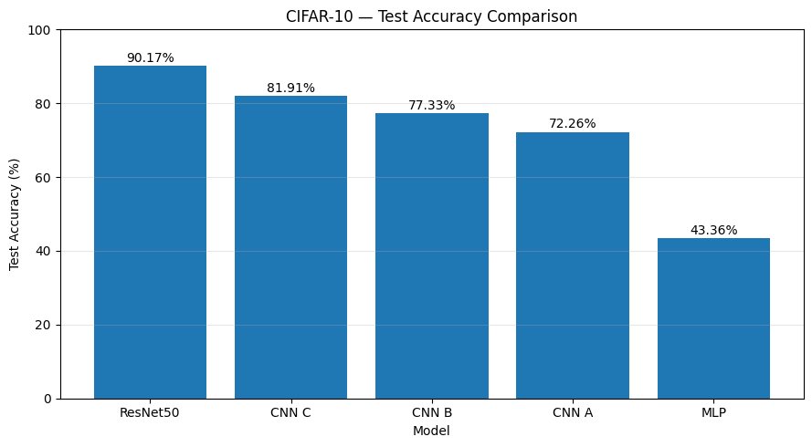

# CIFAR-10 Model Studio

An interactive deep learning project for image classification using the CIFAR-10 dataset. This project compares five neural network models and provides a Streamlit application to explore their predictions.

## Project Overview

The goal of this project is to explore image classification with deep learning, compare different model architectures, and apply transfer learning using ResNet50 pretrained on ImageNet.

## Models

Five models are trained and evaluated:

- **MLP** — Multilayer Perceptron baseline
- **CNN A** — Convolutional Neural Network baseline
- **CNN B** — Deeper CNN architecture
- **CNN C** — CNN with Batch Normalization and data augmentation
- **ResNet50** — Transfer learning using ImageNet pretrained weights

## Test Results

| Model | Test Accuracy |
|---|---:|
| MLP | 43.36% |
| CNN A | 72.26% |
| CNN B | 77.33% |
| CNN C | 81.91% |
| ResNet50 | 90.17% |

ResNet50 achieved the highest test accuracy among the five evaluated models in our experiments.



Training curves, example predictions, error analysis and the ResNet50 confusion matrix are available in [`results/figures/`](results/figures/).

## Application Features

- Upload an image and obtain a predicted class
- Select a model or compare predictions across models
- Display predicted classes and confidence scores
- Compare the test accuracy of the five models

## Dataset

CIFAR-10 contains 60,000 color images divided into 10 classes:

airplane, automobile, bird, cat, deer, dog, frog, horse, ship, and truck.

The dataset is divided into 50,000 training images and 10,000 test images.

## Technologies

- Python
- TensorFlow / Keras
- NumPy
- Pandas
- Matplotlib
- Streamlit

## Project Structure

```text
cifar10-model-studio/
├── notebooks/
│   └── cifar10_model_training_ipynb.ipynb   # training, evaluation, comparison
├── app/
│   └── app.py                               # Streamlit application
├── data/
│   └── raw/cifar-10-batches-py/             # CIFAR-10 files (not versioned)
├── models/
│   ├── mlp/                                 # model_mlp.keras
│   ├── cnn_a/                               # cnn_a_cifar10.keras
│   ├── cnn_b/                               # cnn_bifar10.keras
│   ├── cnn_c/                               # cnn_cifar10.keras
│   └── resnet50/                            # resnet50_cifar10.keras (not versioned)
├── results/
│   ├── figures/                             # curves, predictions, confusion matrix
│   └── metrics/                             # histories, metrics, summary CSV
├── requirements.txt
├── README.md
└── .gitignore
```

## Installation

1. Clone this repository:

```bash
git clone https://github.com/MOURADBAHADDOU/cifar10-model-studio.git
cd cifar10-model-studio
```

2. Install the dependencies:

```bash
pip install -r requirements.txt
```

3. Download CIFAR-10 (Python version) from https://www.cs.toronto.edu/~kriz/cifar.html and place it in `data/raw/cifar-10-batches-py/` (see [`data/README.md`](data/README.md)). This is only needed to run the notebook.

## Run the Notebook

Open `notebooks/cifar10_model_training_ipynb.ipynb` **from the `notebooks/` folder**, because the code uses relative paths (`../data`, `../models`, `../results`). Trained models, metrics and figures are written to `models/` and `results/`.

On Google Colab, clone the repository and run `%cd cifar10-model-studio/notebooks` before executing the cells. The `drive.mount`, `files.download` and ngrok cells are only meant for Colab.

## Run the Application

From the root of the project:

```bash
streamlit run app/app.py
```

**Important:** `app.py` loads the five trained models from the `models/` folder. The MLP, CNN A, CNN B and CNN C models are included in this repository. The ResNet50 model (~95 MB) is not versioned: place `resnet50_cifar10.keras` in `models/resnet50/` (download it from the repository's Releases, or retrain it with the notebook) before starting the application.

## Where Files Are Stored

| The code reads / writes | Location |
|---|---|
| CIFAR-10 batches | `data/raw/cifar-10-batches-py/` |
| Trained models (`.keras`) | `models/<model>/` |
| Histories and metrics (`.joblib`) | `results/metrics/<model>/` |
| Curves and comparison charts (`.png`) | `results/figures/` |
| Streamlit app | `app/app.py` |

## What I Learned

- Image preprocessing and data preparation
- Building and training neural networks with TensorFlow/Keras
- Comparing MLP and CNN architectures
- Using Batch Normalization and data augmentation
- Applying transfer learning with ResNet50
- Evaluating classification models on a test dataset
- Building an interactive application with Streamlit

## Future Improvements

- Improve the deployment workflow
- Provide access to the ResNet50 model weights through GitHub Releases
- Add more evaluation metrics and error analysis

Developed as a deep learning portfolio project focused on image classification and model comparison.
